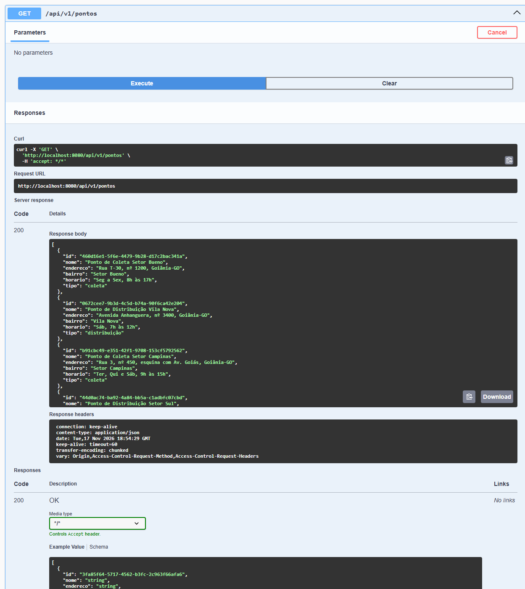
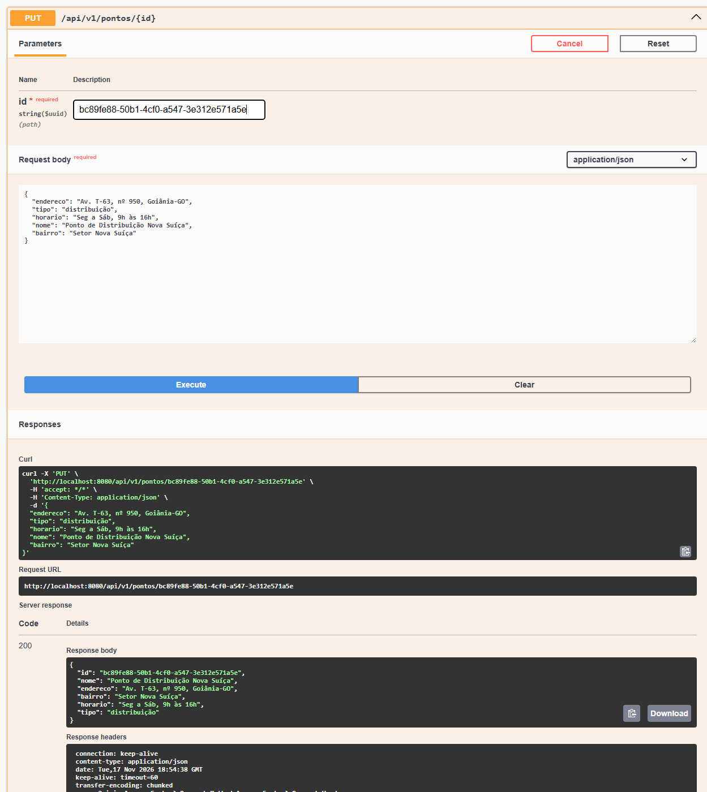
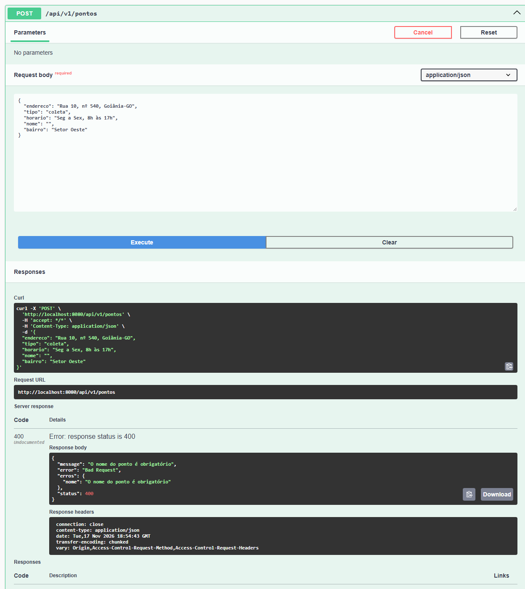
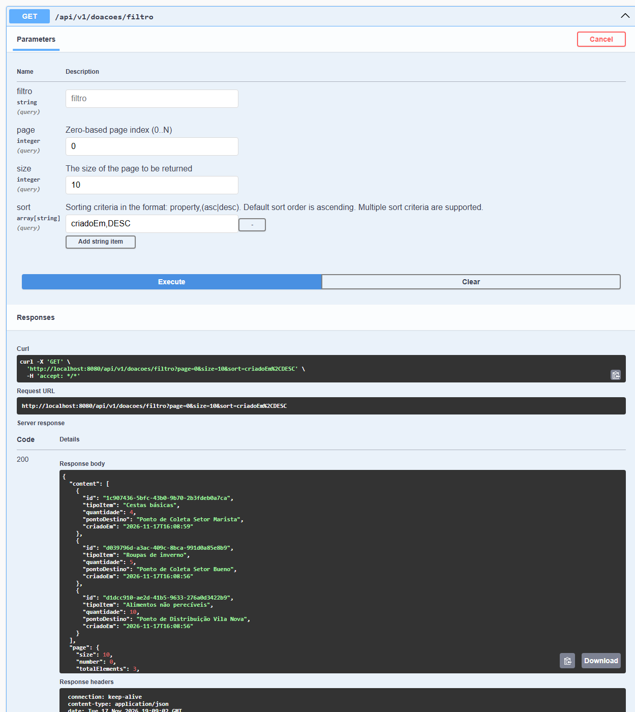
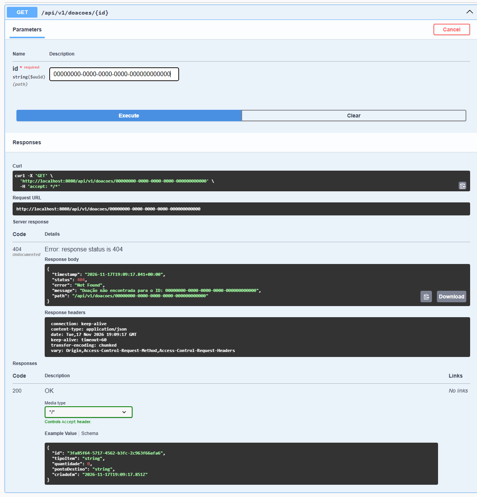

# Instituto Mão Amiga

Aplicativo em React Native com Expo (Android, iOS e Web) integrado à **API Spring Boot** própria localizada na pasta [`api/`](api/) deste repositório. Pontos de coleta/distribuição e doações possuem CRUD completo via HTTP, busca paginada na API e favoritos locais por `id` no aparelho.

---

## Onde está a API e como rodar

A API está na pasta **`api/`** deste mesmo repositório (seguindo o padrão arquitetural da Compre Bem: Spring Boot `3.2.5`, **Java 17**, Spring Web, Spring Data JPA, Bean Validation, H2 em arquivo, Lombok e Swagger/OpenAPI).

### Pré-requisitos
- **Java 17** (`java -version` → OpenJDK/JDK 17)
- **Node.js** e **pnpm** (ou npm) para o aplicativo Expo

### 1. Rodar a API (`api/`)

```powershell
cd api
.\mvnw.cmd spring-boot:run
```

> Em Linux/macOS, use `./mvnw spring-boot:run`.

- **Base URL:** `http://localhost:8080`
- **Swagger UI:** `http://localhost:8080/swagger-ui.html`
- **Console H2:** `http://localhost:8080/h2-console`
  - **JDBC URL:** `jdbc:h2:file:./data/maoamigadb`
  - **User Name:** `sa` | **Password:** *(vazio)*
- **Carga inicial:** 25 pontos reais em Goiânia inseridos automaticamente na primeira execução, sem duplicar ao reiniciar a API.

### 2. Rodar o App (raiz do repositório)

```powershell
pnpm install
pnpm start
```

Para abrir diretamente no navegador:

```powershell
pnpm web
```

> No Windows, você também pode abrir `iniciar-web.cmd` com dois cliques.

### Onde trocar o IP da API (`src/services/api.ts`)

A URL base do servidor fica em um único lugar: [`src/services/api.ts`](src/services/api.ts).

```ts
const IP_REDE_LOCAL = '10.1.10.120';
const EH_NAVEGADOR = typeof window !== 'undefined' && typeof document !== 'undefined';

export const API_BASE_URL = EH_NAVEGADOR
  ? 'http://localhost:8080'
  : `http://${IP_REDE_LOCAL}:8080`;
```

- **Celular pela rede local (Expo Go):** troque `IP_REDE_LOCAL` em `src/services/api.ts` pelo IPv4 do seu computador na mesma rede Wi-Fi (não use `localhost` no celular) e mantenha a API ativa na porta `8080`.
- **Validação desta entrega:** o app foi testado no **navegador** (Chrome) conectado à API local rodando na porta `8080` (além da verificação com a API desligada), com testes automatizados (`pnpm test`), `expo-doctor` e exportações web, Android e iOS (`pnpm exportar:web` e `pnpm exportar:nativo`).

### Comandos úteis

| Contexto | Comando | Finalidade |
|---|---|---|
| API | `cd api; .\mvnw.cmd spring-boot:run` | Iniciar a API na porta `8080` |
| API | `cd api; .\mvnw.cmd test` | Executar testes de integração Spring Boot (`PontoControllerTest` e `DoacaoControllerTest`) |
| App | `pnpm start` | Iniciar servidor Expo (QR code para Expo Go) |
| App | `pnpm web` | Abrir o app no navegador |
| App | `pnpm test` | Executar testes unitários do app (`node --test`) |
| App | `pnpm verificar` | Executar `expo-doctor` |
| App | `pnpm exportar:web` | Gerar exportação web (`dist/`) |
| App | `pnpm exportar:nativo` | Gerar bundles nativos Android e iOS (`dist-nativo/`) |

---

## Endpoints da API

### Pontos de Coleta (`[N2-1]` e `[N2-2]`)

| Método | URL | Descrição | Status |
|---|---|---|---|
| `GET` | `http://localhost:8080/api/v1/pontos` | Lista todos os pontos (usado na seleção de destino das doações) | `200 OK` |
| `GET` | `http://localhost:8080/api/v1/pontos/filtro?filtro=...&page=0&size=10` | Busca paginada por `nome` ou `bairro` (`content` + `page`, padrão 10 itens ordenados por `nome`; aceita `sort=bairro,asc`) | `200 OK` |
| `GET` | `http://localhost:8080/api/v1/pontos/{id}` | Busca um ponto pelo UUID | `200 OK` / `404 Not Found` |
| `POST` | `http://localhost:8080/api/v1/pontos` | Cadastra um novo ponto (Bean Validation) | `201 Created` / `400 Bad Request` |
| `PUT` | `http://localhost:8080/api/v1/pontos/{id}` | Atualiza um ponto existente | `200 OK` / `400 Bad Request` / `404 Not Found` |
| `DELETE` | `http://localhost:8080/api/v1/pontos/{id}` | Exclui um ponto pelo UUID | `204 No Content` / `404 Not Found` |

#### Evidências no Swagger UI — Pontos (`[N2-1]`)

- **GET `/api/v1/pontos` (200):**
  
- **GET `/api/v1/pontos/{id}` (200):**
  
- **POST `/api/v1/pontos` (201):**
  
- **PUT `/api/v1/pontos/{id}` (200):**
  
- **DELETE `/api/v1/pontos/{id}` (204):**
  
- **POST `/api/v1/pontos` com campo obrigatório vazio (400):**
  
- **GET `/api/v1/pontos/{id}` com id inexistente (404):**
  

#### Chamadas e Respostas de Busca Paginada (`[N2-2]`)

1. **Sem filtro (página 0, 10 itens ordenados por `nome`):**
   ```http
   GET http://localhost:8080/api/v1/pontos/filtro?page=0&size=10
   ```
   ```json
   {
     "content": [
       {
         "id": "11e395fe-f1a7-4e0f-9ef8-d64ad1035a13",
         "nome": "Apoio Solidário Setor Bela Vista",
         "endereco": "Avenida T-2, nº 980, Goiânia-GO",
         "bairro": "Setor Bela Vista",
         "horario": "Seg a Sex, 8h às 16h",
         "tipo": "coleta"
       },
       {
         "id": "47411513-b44d-449f-a837-61844faf5aa9",
         "nome": "Casa Solidária Setor Jaó",
         "endereco": "Avenida Professor Venerando de Freitas, nº 430, Goiânia-GO",
         "bairro": "Setor Jaó",
         "horario": "Ter a Sáb, 9h às 15h",
         "tipo": "coleta"
       },
       "... (10 itens na página 0)"
     ],
     "page": {
       "size": 10,
       "number": 0,
       "totalElements": 25,
       "totalPages": 3
     }
   }
   ```

2. **Filtrando por bairro (`filtro=Bueno`):**
   ```http
   GET http://localhost:8080/api/v1/pontos/filtro?filtro=Bueno&page=0&size=10
   ```
   ```json
   {
     "content": [
       {
         "id": "d9a4ce38-bad9-4b1f-8002-24a8d2626458",
         "nome": "Espaço Mão Amiga T-63",
         "endereco": "Avenida T-63, nº 1420, Goiânia-GO",
         "bairro": "Setor Bueno",
         "horario": "Seg a Sex, 9h às 18h",
         "tipo": "distribuição"
       },
       {
         "id": "215281e4-0271-4817-b306-5eca8fccb26c",
         "nome": "Núcleo Comunitário Parque Vaca Brava",
         "endereco": "Avenida T-10, nº 890, Goiânia-GO",
         "bairro": "Setor Bueno",
         "horario": "Ter a Sáb, 8h às 14h",
         "tipo": "coleta"
       },
       {
         "id": "53a25bb8-4b8a-4ced-b359-280e2c6065d1",
         "nome": "Ponto de Coleta Setor Bueno",
         "endereco": "Rua T-30, nº 1200, Goiânia-GO",
         "bairro": "Setor Bueno",
         "horario": "Seg a Sex, 8h às 17h",
         "tipo": "coleta"
       }
     ],
     "page": {
       "size": 10,
       "number": 0,
       "totalElements": 3,
       "totalPages": 1
     }
   }
   ```

3. **Segunda página (`page=1&size=10`):**
   ```http
   GET http://localhost:8080/api/v1/pontos/filtro?page=1&size=10
   ```
   ```json
   {
     "content": [
       {
         "id": "0da14ade-46f2-43d7-a2ef-ce18042584cf",
         "nome": "Ponto de Coleta Parque Atheneu",
         "endereco": "Avenida Parque Atheneu, nº 1250, Goiânia-GO",
         "bairro": "Parque Atheneu",
         "horario": "Seg a Sex, 9h às 17h",
         "tipo": "coleta"
       },
       "... (10 itens na página 1)"
     ],
     "page": {
       "size": 10,
       "number": 1,
       "totalElements": 25,
       "totalPages": 3
     }
   }
   ```

> **Ordenação por bairro:** `GET /api/v1/pontos/filtro?sort=bairro,asc&page=0&size=10` altera a ordenação para ordem crescente por bairro (`Centro`, `Jardim América`, `Jardim Goiás`, ...).

---

### Doações (`[N2-5]`)

| Método | URL | Descrição | Status |
|---|---|---|---|
| `GET` | `http://localhost:8080/api/v1/doacoes/filtro?filtro=...&page=0&size=10` | Lista paginada filtrando por `tipoItem` (case-insensitive), da mais nova para a mais antiga (`criadoEm DESC`) | `200 OK` |
| `GET` | `http://localhost:8080/api/v1/doacoes/{id}` | Busca uma doação pelo UUID | `200 OK` / `404 Not Found` |
| `POST` | `http://localhost:8080/api/v1/doacoes` | Cadastra doação (`criadoEm` gerado no servidor com `LocalDateTime.now()`) | `201 Created` / `400 Bad Request` |
| `PUT` | `http://localhost:8080/api/v1/doacoes/{id}` | Atualiza doação preservando `id` e `criadoEm` | `200 OK` / `400 Bad Request` / `404 Not Found` |
| `DELETE` | `http://localhost:8080/api/v1/doacoes/{id}` | Exclui uma doação pelo UUID | `204 No Content` / `404 Not Found` |

#### Evidências no Swagger UI — Doações (`[N2-5]`)

- **POST `/api/v1/doacoes` (201):**
  
- **GET `/api/v1/doacoes/filtro` (200):**
  
- **GET `/api/v1/doacoes/{id}` (200):**
  
- **PUT `/api/v1/doacoes/{id}` (200):**
  
- **DELETE `/api/v1/doacoes/{id}` (204):**
  
- **POST `/api/v1/doacoes` com quantidade zero (400):**
  
- **GET `/api/v1/doacoes/{id}` com id inexistente (404):**
  

---

## Arquitetura do App e Decisão Técnica

### Camadas de Rede e Telas

| Camada / Arquivo | Responsabilidade |
|---|---|
| `src/services/api.ts` | **Único arquivo** que chama `fetch`, centraliza `API_BASE_URL`, expõe `get`, `post`, `put` e `del` e lança `ApiError` com `status`. |
| `src/services/pontosService.ts` | Operações de pontos (`listar`, `buscarPagina`, `buscarPorId`, `cadastrar`, `editar`, `excluir`) delegando 100% para `api.ts`. |
| `src/services/doacoesService.ts` | Operações de doações (`buscarPagina`, `buscarPorId`, `cadastrar`, `editar`, `excluir`) delegando 100% para `api.ts`. |
| `src/services/favoritosService.ts` | Persiste **somente os `id`s** dos pontos favoritados no `AsyncStorage` (`@instituto_mao_amiga:favoritos`). |
| `TelaPontos.js` | Lista paginada com rolagem infinita (`onEndReached`), busca na API, botão de favorito (`♡`/`♥` ≥44×44) e acesso a **Novo ponto**, **Meus pontos**, **Cadastrar doação** e **Ver histórico**. |
| `TelaDetalhePonto.js` | Busca o ponto na API apenas pelo `id` (`404` mostra `"Ponto não encontrado"`), com ações de editar e excluir com confirmação (`Alert.alert`). |
| `TelaFormularioPonto.js` | Formulário único reutilizado para cadastrar (`POST`) e editar (`PUT` com botão `"Salvar alterações"`), com dois `TouchableOpacity` para `"coleta"` e `"distribuição"`. |
| `TelaMeusPontos.js` | Lê os `id`s salvos no `AsyncStorage`, busca cada ponto atualizado na API pelo `id` (ignorando `404` sem quebrar) e permite desmarcar na hora. |
| `TelaHistoricoDoacoes.js` | Histórico paginado com `FlatList`, `keyExtractor` por `id`, rolagem infinita, busca por `tipoItem` na API e estados próprios de carregando, erro e vazio. |
| `TelaFormularioDoacao.js` | Formulário único reutilizado para cadastrar (`POST`) e editar (`PUT` com `"Salvar alterações"`), com seleção do ponto de destino entre os pontos da API (`TouchableOpacity` por ponto). |
| `TelaDetalheDoacao.js` | Busca a doação na API apenas pelo `id` (`404` mostra `"Doação não encontrada"`), permite editar e excluir com confirmação (`Alert.alert`). |

### Decisão Técnica da Semana

**Por que os favoritos ficam no `AsyncStorage` do aparelho (apenas os `id`s), enquanto pontos e doações ficam no servidor (API)?**

1. **Dados compartilhados vs. preferência local sem login:** pontos de coleta e doações representam dados institucionais compartilhados que precisam de validação no servidor (`Bean Validation`), paginação e persistência centralizada no H2 em arquivo. Já os favoritos são uma preferência pessoal de quem usa o aparelho e o app não possui autenticação/contas — salvá-los localmente no `AsyncStorage` evita misturar favoritos de usuários diferentes no backend.
2. **Persistir somente os `id`s (e buscar na API):** se guardássemos o objeto completo do ponto no `AsyncStorage`, qualquer edição de endereço ou horário ficaria desatualizada. Guardando apenas os `id`s, a tela **Meus pontos** consulta a API em tempo real: exibe sempre os dados atuais e ignora silenciosamente eventuais pontos excluídos (`404`) sem quebrar a interface.

---

## Roteiro de Demonstração (até 3 minutos)

Consulte também a versão detalhada em [`docs/roteiro-demonstracao.md`](docs/roteiro-demonstracao.md).

1. **Pontos — buscar, cadastrar, editar e excluir (~55s):**
   - Na lista inicial, buscar por `Bueno` (filtragem via API) e limpar a busca para mostrar a rolagem infinita dos 25 pontos.
   - Tocar em **Novo ponto**, preencher os 5 campos, escolher **Coleta** (`TouchableOpacity`) e cadastrar (`POST`). Confirmar que aparece na lista sem fechar o app.
   - Abrir o ponto criado, tocar em **Editar ponto**, alterar para **Distribuição** e clicar em **Salvar alterações** (`PUT`). Conferir no detalhe e na lista.
   - Tocar em **Excluir ponto**, confirmar em **Excluir** (`DELETE`) e verificar que sumiu da lista.
2. **Favoritos e "Meus pontos" (~35s):**
   - Tocar em `♡` → `♥` em dois pontos da lista e abrir **Meus pontos**.
   - Recarregar o app/página para comprovar persistência dos `id`s no `AsyncStorage`.
   - Clicar em **Desmarcar** em um item dentro de **Meus pontos** e verificar remoção imediata.
3. **Doações — cadastrar, editar e excluir (~50s):**
   - Tocar em **Cadastrar doação**, preencher item e quantidade, escolher um ponto da API (`TouchableOpacity`) e salvar (`POST`). Mostrar a nova doação no topo do histórico.
   - Abrir o detalhe (buscado pelo `id`), tocar em **Editar doação**, alterar a quantidade e salvar em **Salvar alterações** (`PUT`), conferindo que `id` e data de cadastro permanecem iguais.
   - Tocar em **Excluir doação**, confirmar em **Excluir** (`DELETE`) e verificar que sumiu do histórico.
4. **Erros `400` e `404` na API (~25s):**
   - No Swagger UI (`http://localhost:8080/swagger-ui.html`), enviar `POST /api/v1/doacoes` com `quantidade: 0` → resposta **400 Bad Request** sem gravar nada.
   - Enviar `GET /api/v1/pontos/00000000-0000-0000-0000-000000000000` → resposta **404 Not Found**.
