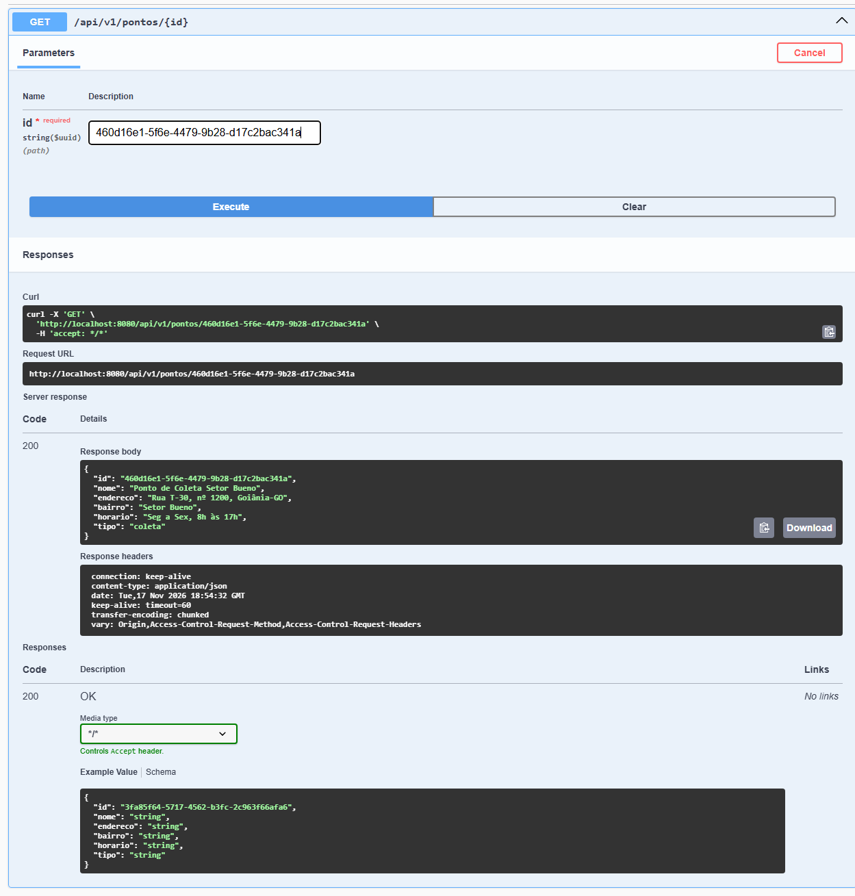
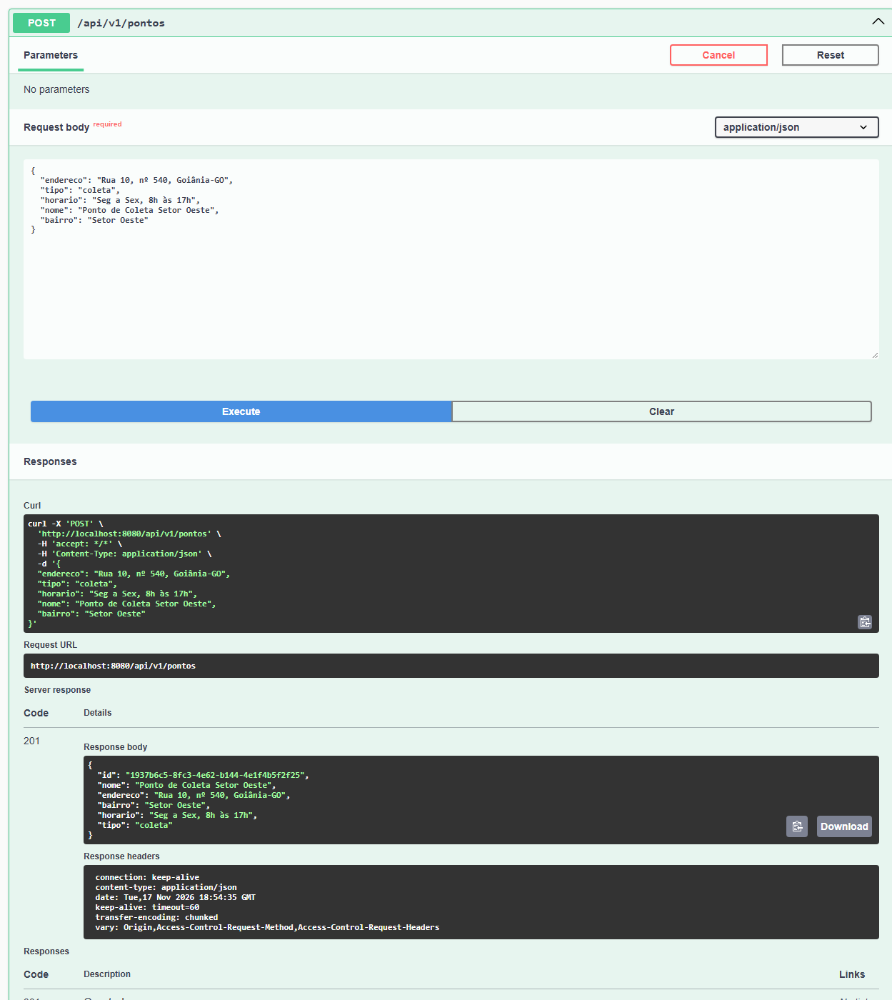
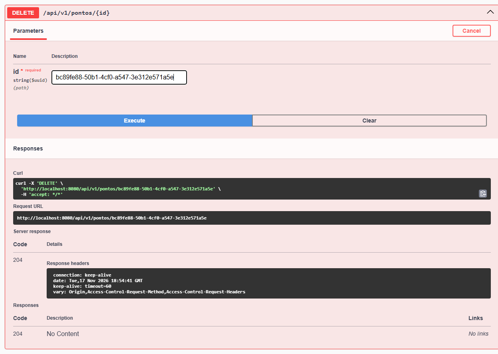
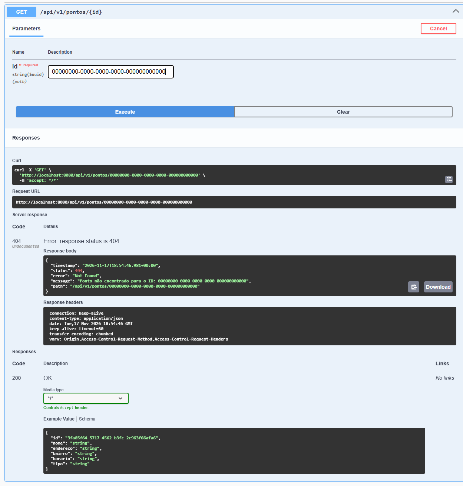
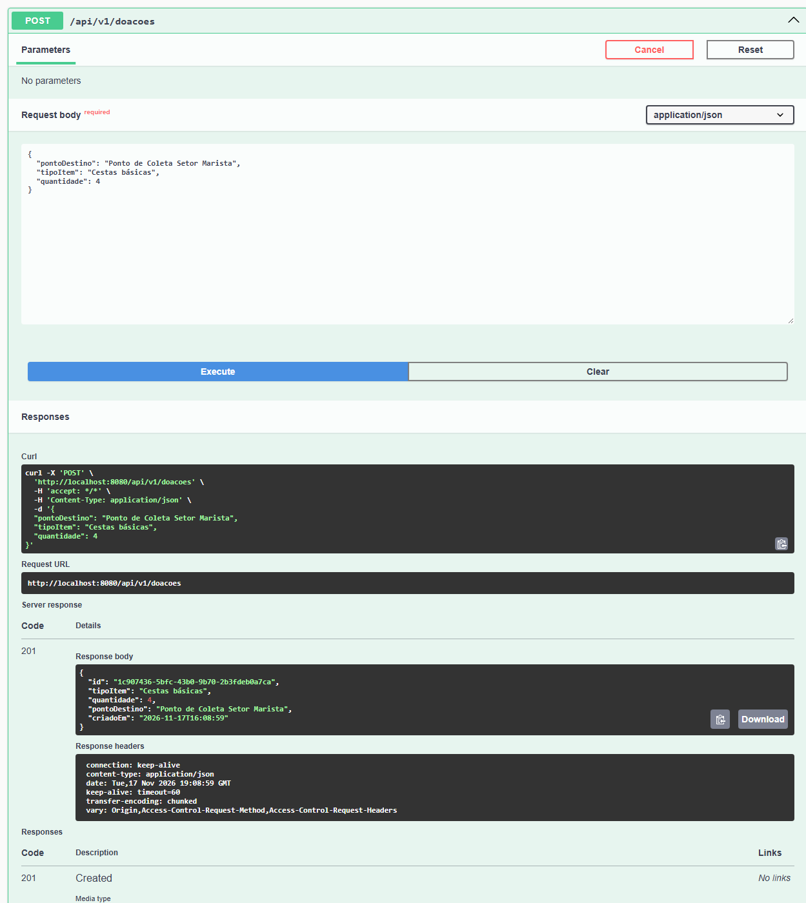
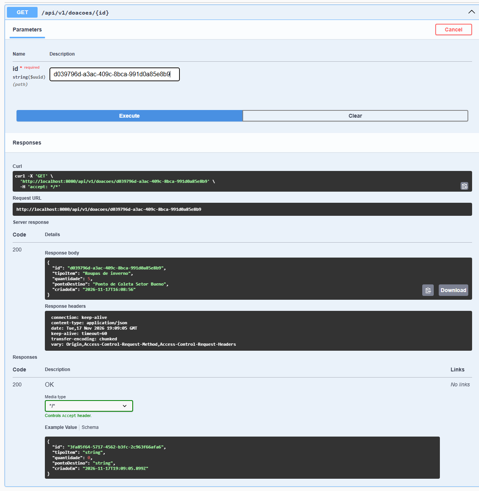
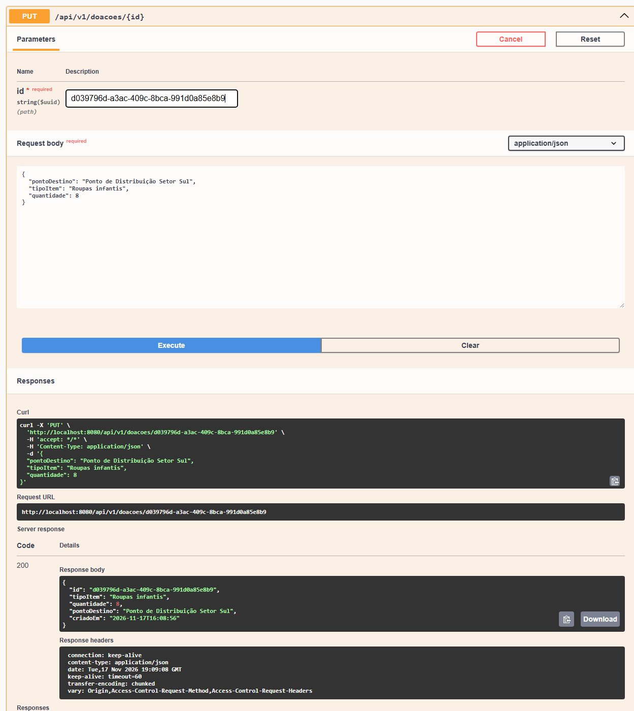
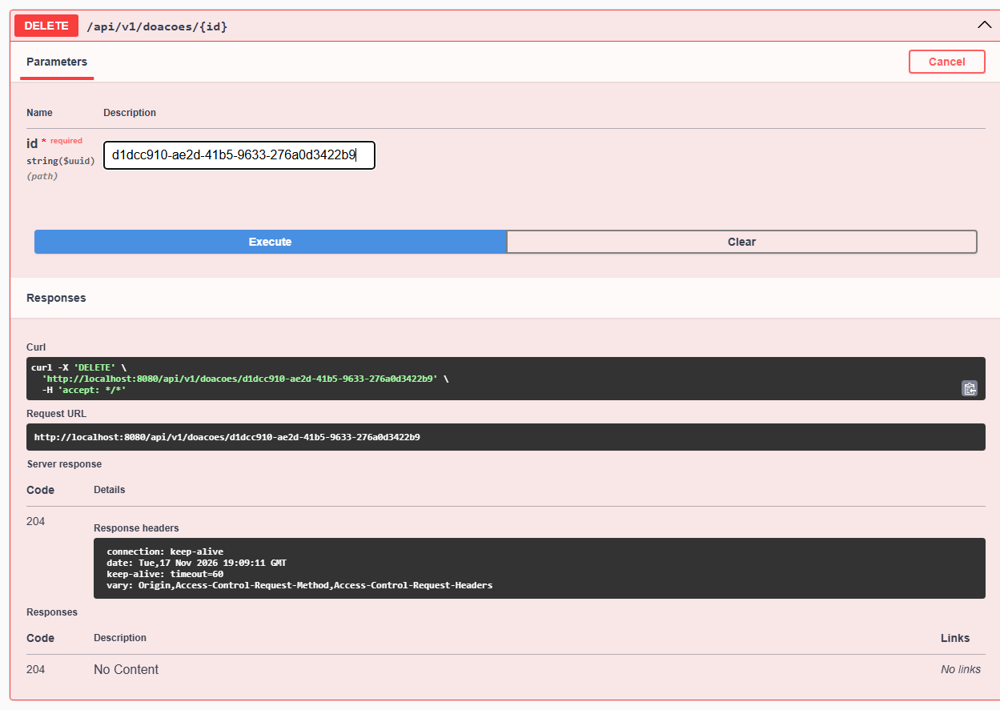
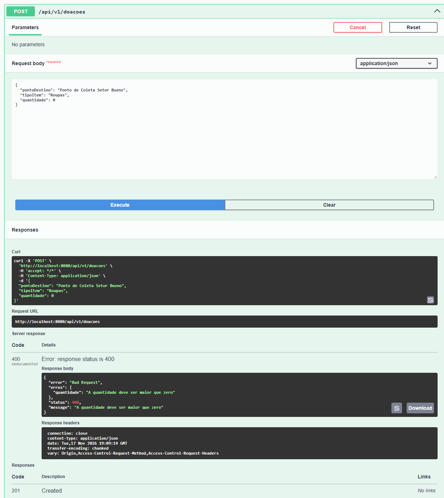

# Instituto Mão Amiga

Aplicativo educacional em React Native com Expo e JavaScript/JSX para Android, iOS e web, integrado à API Spring Boot do projeto localizada na pasta [`api/`](api/).

## API Spring Boot (`api/`)

A API está localizada na pasta `api/` deste repositório (Java 17, Spring Boot 3.2.5, Spring Web, Spring Data JPA, Bean Validation, H2 em arquivo `jdbc:h2:file:./data/maoamigadb`, Lombok e Swagger/OpenAPI).

### Como rodar a API

```powershell
cd api
.\mvnw.cmd spring-boot:run
```

- **Swagger UI:** `http://localhost:8080/swagger-ui.html`
- **Console H2:** `http://localhost:8080/h2-console` (JDBC URL: `jdbc:h2:file:./data/maoamigadb`, usuário `sa`, senha vazia)

### Endpoints de Pontos de Coleta (`[N2-1]`)

| Método | URL | Descrição | Status |
|---|---|---|---|
| `GET` | `http://localhost:8080/api/v1/pontos` | Lista todos os pontos de coleta/distribuição | `200 OK` |
| `GET` | `http://localhost:8080/api/v1/pontos/filtro?filtro=...&page=0&size=10` | Busca paginada por nome ou bairro (`content` + `page`, padrão 10 itens ordenados por `nome`) | `200 OK` |
| `GET` | `http://localhost:8080/api/v1/pontos/{id}` | Busca um ponto pelo UUID | `200 OK` / `404 Not Found` |
| `POST` | `http://localhost:8080/api/v1/pontos` | Cadastra um novo ponto (com validação Bean Validation) | `201 Created` / `400 Bad Request` |
| `PUT` | `http://localhost:8080/api/v1/pontos/{id}` | Atualiza um ponto existente | `200 OK` / `400 Bad Request` / `404 Not Found` |
| `DELETE` | `http://localhost:8080/api/v1/pontos/{id}` | Exclui um ponto pelo UUID | `204 No Content` / `404 Not Found` |

#### Evidências no Swagger UI — Pontos (`[N2-1]`)

- **GET `/api/v1/pontos` (200):**
  
- **GET `/api/v1/pontos/{id}` (200):**
  
- **POST `/api/v1/pontos` (201):**
  
- **PUT `/api/v1/pontos/{id}` (200):**
  
- **DELETE `/api/v1/pontos/{id}` (204):**
  
- **POST `/api/v1/pontos` com campo obrigatório vazio (400):**
  
- **GET `/api/v1/pontos/{id}` com id inexistente (404):**
  

### Busca Paginada de Pontos (`[N2-2]`)

O endpoint `GET /api/v1/pontos/filtro` busca por `nome` ou `bairro` sem diferenciar maiúsculas/minúsculas (`@Query`), devolve no formato `content` + `page` (`spring.data.web.pageable.serialization-mode=via_dto`), usa padrão de 10 itens ordenados por `nome` (`@PageableDefault`) e aceita ordenação customizada como `sort=bairro,asc`. A carga inicial possui 25 pontos reais em Goiânia.

#### 1. Sem filtro (página 0, 10 itens ordenados por `nome`)

```http
GET http://localhost:8080/api/v1/pontos/filtro?page=0&size=10
```

```json
{
  "content": [
    {
      "id": "11e395fe-f1a7-4e0f-9ef8-d64ad1035a13",
      "nome": "Apoio Solidário Setor Bela Vista",
      "endereco": "Avenida T-2, nº 980, Goiânia-GO",
      "bairro": "Setor Bela Vista",
      "horario": "Seg a Sex, 8h às 16h",
      "tipo": "coleta"
    },
    {
      "id": "47411513-b44d-449f-a837-61844faf5aa9",
      "nome": "Casa Solidária Setor Jaó",
      "endereco": "Avenida Professor Venerando de Freitas, nº 430, Goiânia-GO",
      "bairro": "Setor Jaó",
      "horario": "Ter a Sáb, 9h às 15h",
      "tipo": "coleta"
    },
    {
      "id": "ad86a581-ef99-4137-9bf8-e67b3b0a9663",
      "nome": "Casa de Apoio Praça Cívica",
      "endereco": "Rua 4, nº 280, Goiânia-GO",
      "bairro": "Centro",
      "horario": "Seg a Sáb, 9h às 17h",
      "tipo": "distribuição"
    },
    "... (10 itens na página 0)"
  ],
  "page": {
    "size": 10,
    "number": 0,
    "totalElements": 25,
    "totalPages": 3
  }
}
```

#### 2. Filtrando por bairro (`filtro=Bueno`)

```http
GET http://localhost:8080/api/v1/pontos/filtro?filtro=Bueno&page=0&size=10
```

```json
{
  "content": [
    {
      "id": "d9a4ce38-bad9-4b1f-8002-24a8d2626458",
      "nome": "Espaço Mão Amiga T-63",
      "endereco": "Avenida T-63, nº 1420, Goiânia-GO",
      "bairro": "Setor Bueno",
      "horario": "Seg a Sex, 9h às 18h",
      "tipo": "distribuição"
    },
    {
      "id": "215281e4-0271-4817-b306-5eca8fccb26c",
      "nome": "Núcleo Comunitário Parque Vaca Brava",
      "endereco": "Avenida T-10, nº 890, Goiânia-GO",
      "bairro": "Setor Bueno",
      "horario": "Ter a Sáb, 8h às 14h",
      "tipo": "coleta"
    },
    {
      "id": "53a25bb8-4b8a-4ced-b359-280e2c6065d1",
      "nome": "Ponto de Coleta Setor Bueno",
      "endereco": "Rua T-30, nº 1200, Goiânia-GO",
      "bairro": "Setor Bueno",
      "horario": "Seg a Sex, 8h às 17h",
      "tipo": "coleta"
    }
  ],
  "page": {
    "size": 10,
    "number": 0,
    "totalElements": 3,
    "totalPages": 1
  }
}
```

#### 3. Segunda página (`page=1&size=10`)

```http
GET http://localhost:8080/api/v1/pontos/filtro?page=1&size=10
```

```json
{
  "content": [
    {
      "id": "0da14ade-46f2-43d7-a2ef-ce18042584cf",
      "nome": "Ponto de Coleta Parque Atheneu",
      "endereco": "Avenida Parque Atheneu, nº 1250, Goiânia-GO",
      "bairro": "Parque Atheneu",
      "horario": "Seg a Sex, 9h às 17h",
      "tipo": "coleta"
    },
    {
      "id": "7ebe745f-74b5-417b-8b18-9f334006afae",
      "nome": "Ponto de Coleta Setor Aeroporto",
      "endereco": "Rua 18-A, nº 520, Goiânia-GO",
      "bairro": "Setor Aeroporto",
      "horario": "Seg a Sex, 8h às 17h",
      "tipo": "coleta"
    },
    "... (10 itens na página 1)"
  ],
  "page": {
    "size": 10,
    "number": 1,
    "totalElements": 25,
    "totalPages": 3
  }
}
```

> **Ordenação por bairro:** chamando `GET /api/v1/pontos/filtro?sort=bairro,asc&page=0&size=10`, a ordenação passa a ser crescente por `bairro` (iniciando por `Centro`, `Jardim América`, `Jardim Goiás`, ...).

### Endpoints de Doações (`[N2-5]`)

| Método | URL | Descrição | Status |
|---|---|---|---|
| `GET` | `http://localhost:8080/api/v1/doacoes/filtro?filtro=...&page=0&size=10` | Lista paginada filtrando por `tipoItem` (case-insensitive), da mais nova para a mais antiga (`criadoEm DESC`) | `200 OK` |
| `GET` | `http://localhost:8080/api/v1/doacoes/{id}` | Busca uma doação pelo UUID | `200 OK` / `404 Not Found` |
| `POST` | `http://localhost:8080/api/v1/doacoes` | Cadastra uma doação (`criadoEm` gerado no servidor) | `201 Created` / `400 Bad Request` |
| `PUT` | `http://localhost:8080/api/v1/doacoes/{id}` | Atualiza uma doação preservando `id` e `criadoEm` | `200 OK` / `400 Bad Request` / `404 Not Found` |
| `DELETE` | `http://localhost:8080/api/v1/doacoes/{id}` | Exclui uma doação pelo UUID | `204 No Content` / `404 Not Found` |

#### Evidências no Swagger UI — Doações (`[N2-5]`)

- **POST `/api/v1/doacoes` (201):**
  
- **GET `/api/v1/doacoes/filtro` (200):**
  
- **GET `/api/v1/doacoes/{id}` (200):**
  
- **PUT `/api/v1/doacoes/{id}` (200):**
  
- **DELETE `/api/v1/doacoes/{id}` (204):**
  
- **POST `/api/v1/doacoes` com quantidade zero (400):**
  
- **GET `/api/v1/doacoes/{id}` com id inexistente (404):**
  

## Executar o projeto

Requisitos: Node.js compatível com a versão do Expo do projeto e pnpm disponível no terminal. As versões das dependências estão em `package.json`; o arquivo de trava do pnpm permite reproduzir a instalação.

Na pasta do projeto:

```powershell
cd C:\Users\Santri\Desktop\instituto_mao_amiga
pnpm install
pnpm start
```

### Android e iPhone com Expo Go

1. Instale uma versão do Expo Go compatível com o SDK do projeto.
2. Conecte computador e aparelho à mesma rede.
3. Execute `pnpm start` e use o QR code exibido pelo Expo. No Android, abra o leitor do Expo Go; no iPhone, use a câmera.
4. Mantenha o servidor de desenvolvimento em execução durante o uso.

Se a rede impedir a conexão local, use `pnpm exec expo start --tunnel`. O Expo poderá solicitar uma dependência para o túnel.

Para abrir um emulador Android configurado no computador, execute `pnpm android`. O comando `pnpm ios` abre o simulador de iOS em um Mac configurado; no Windows, teste iOS em um iPhone com Expo Go.

### Navegador e configuração do IP da API (`src/services/api.ts`)

A URL base da API fica centralizada em um único arquivo: [`src/services/api.ts`](src/services/api.ts) (`IP_REDE_LOCAL` e `API_BASE_URL`).

- **No navegador do computador** (`pnpm web` ou `iniciar-web.cmd`): o app usa automaticamente `http://localhost:8080`.
- **No celular pela rede local (Expo Go)**: abra `src/services/api.ts` e altere `IP_REDE_LOCAL` para o IPv4 do computador na mesma rede Wi-Fi (ex.: `10.1.10.120`), mantendo a API rodando na porta `8080`.
- **Validação desta entrega:** os fluxos interativos foram testados no navegador com a API local em execução (e com a API desligada para validar os estados de erro), além da geração dos bundles nativos Android e iOS (`pnpm exportar:nativo`).

No Windows, você também pode abrir `iniciar-web.cmd` com dois cliques. Ele encontra o pnpm instalado e, neste computador, pode usar o runtime disponível no Codex.

```powershell
pnpm web
```

Abra o endereço apresentado pelo Expo. Use o mesmo endereço, porta e perfil de navegador ao verificar a persistência: cada origem do navegador possui seu próprio armazenamento.

### Comandos disponíveis

| Comando | Finalidade |
|---|---|
| `pnpm start` | Iniciar o servidor do Expo e mostrar as opções de abertura. |
| `pnpm android` | Iniciar o Expo para Android. |
| `pnpm ios` | Iniciar o Expo para iOS; simulador exige macOS. |
| `pnpm web` | Iniciar o aplicativo no navegador. |
| `pnpm test` | Executar os testes automatizados com `node --test`. |
| `pnpm verificar` | Verificar compatibilidade e configuração com Expo Doctor. |
| `pnpm exportar:web` | Gerar a exportação web com `expo export --platform web`. |
| `pnpm exportar:nativo` | Gerar os bundles de Android e iOS com `expo export --platform android --platform ios`. |

A exportação nativa verifica a geração dos bundles; ela não gera um APK ou IPA instalável. Os comandos equivalentes podem ser executados com npm em uma instalação normal de Node que inclua npm: use `npm install`, `npm start` e `npm run <nome-do-script>`. O gerenciador e o arquivo de trava usados nesta entrega são os do pnpm.

## Telas e comportamento

| Tela | Funções |
|---|---|
| Pontos de coleta | Entrada do aplicativo, lista dos três pontos e acesso ao cadastro e ao histórico. |
| Detalhe do ponto | Nome, endereço e descrição demonstrativos; cadastro com o ponto previamente selecionado. |
| Cadastrar / Editar doação | Formulário único com tipo livre, quantidade e seleção do ponto; validação preserva o preenchimento. |
| Minhas doações | Histórico com FlatList, busca enquanto você digita e resumo global. |
| Detalhe da doação | Todos os dados do registro, edição e exclusão com confirmação. |

Ponto Centro, Ponto Norte e Ponto Sul têm endereços e descrições fictícios. O histórico começa vazio. Após salvar um cadastro, o aplicativo abre o histórico atualizado. Após editar, retorna ao detalhe atualizado. Cancelar um formulário retorna à origem sem gravar. A exclusão retorna ao histórico depois da confirmação e da gravação bem-sucedida.

A busca considera trechos do tipo de item, sem distinguir maiúsculas e minúsculas. Limpar a busca recupera a lista completa. O resumo sempre utiliza todas as doações, mesmo com uma busca ativa: exibe o número de registros e, por tipo, unidades e número de doações, em ordem decrescente de quantidade. Tipos como `Roupa` e `roupa`, com espaços excedentes, pertencem ao mesmo grupo; `roupa` e `roupas` são grupos distintos.

## Dados e decisões técnicas

Cada registro possui o contrato:

```js
{ id, tipoItem, quantidade, pontoDestino, criadoEm }
```

| Campo | Significado |
|---|---|
| `id` | UUID do registro, criado uma única vez. |
| `tipoItem` | Texto obrigatório, sem espaços excedentes nas extremidades. |
| `quantidade` | Número inteiro positivo; vazio, letras, zero, negativos e frações são rejeitados. |
| `pontoDestino` | Identificador de um ponto do catálogo; a interface apresenta seu nome. |
| `criadoEm` | Data e hora originais em ISO, exibidas em português do Brasil. |

A edição preserva `id` e `criadoEm`, atualizando o registro sem criar uma cópia. O histórico apresenta primeiro os cadastros mais recentes.

- `src/armazenamento/doacoesStorage.js` concentra o acesso ao AsyncStorage e expõe `listarDoacoes()`, `salvarDoacao(doacao)`, `atualizarDoacao(doacao)` e `excluirDoacao(id)`. As telas não acessam AsyncStorage diretamente.
- O estado compartilhado na raiz alimenta as telas por props. O detalhe recebe a doação em `route.params` e consulta seu identificador no estado atualizado para refletir edições.
- Salvar e excluir aguardam a gravação antes de atualizar a interface ou indicar sucesso. Durante uma gravação, ações repetidas ficam indisponíveis. Falhas são apresentadas em português.
- A lista filtrada e os totais são calculados a partir do histórico completo; não são persistidos nem mantidos como cópias independentes no estado.
- A FlatList usa o `id` como chave, com componente separado para cada item e `React.memo`.
- React Navigation Native Stack organiza as cinco telas. Safe areas, Flexbox e proteção contra o teclado atendem tamanhos diferentes. Os controles têm alvo de toque mínimo de 44×44.
- Android e iOS usam `Alert.alert` para confirmar a exclusão. A web usa um diálogo acessível com as mesmas ações “Cancelar” e “Excluir”.

Dependências principais: Expo, React, React Native, `@react-navigation/native`, `@react-navigation/native-stack`, `@react-native-async-storage/async-storage`, `react-native-screens`, `react-native-safe-area-context`, `expo-crypto`, `react-dom`, `react-native-web` e `@expo/metro-runtime`.

O armazenamento é separado por instalação e por origem/perfil de navegador. Não há backend, conta de usuário ou sincronização entre dispositivos. Limpar os dados da instalação ou do navegador remove o histórico local.

## Validar a entrega

Execute `pnpm test`, `pnpm verificar`, `pnpm exportar:web` e `pnpm exportar:nativo`. Testes e exportação não substituem o uso em aparelhos para verificar teclado, navegação e acessibilidade.

A implementação passou em 28 testes automatizados, 21 verificações do Expo Doctor e nas exportações web, Android e iOS. Os fluxos web foram exercitados em 320×720 e 768×720. Consulte o [registro de validação](docs/validacao.md) para as evidências e os limites de cada teste.

| Cenário | Android | iOS | Web |
|---|---|---|---|
| Consultar os três pontos e voltar ao ponto correto | Pendente | Pendente | Aprovado |
| Histórico vazio permite iniciar o cadastro | Pendente | Pendente | Aprovado |
| Cadastrar três doações e preservar os registros anteriores | Pendente | Pendente | Aprovado |
| Validar vazio, letras, zero, negativos e frações sem apagar campos | Pendente | Pendente | Aprovado |
| Detalhe mostra tipo, quantidade, destino, ID e data corretos | Pendente | Pendente | Aprovado |
| Editar preserva ID e data; cancelar preserva os valores | Pendente | Pendente | Aprovado |
| Excluir: cancelar preserva; confirmar remove e atualiza os totais | Pendente | Pendente | Aprovado |
| Busca por trecho e caixa; limpar restaura; vazio cita a busca | Pendente | Pendente | Aprovado |
| Resumo global agrupa e ordena corretamente após mudanças | Pendente | Pendente | Aprovado |
| Fechar realmente e reabrir conserva o histórico restante | Pendente | Pendente | Parcial: nova aba; processo do navegador pendente |
| Histórico, detalhe e edição em dois tamanhos, sem cortes | Pendente | Pendente | Aprovado |
| Formulário e busca visíveis com teclado aberto; alvos ≥44×44 | Pendente | Pendente | Alvos aprovados; teclado virtual pendente |
| Leitor de tela e, na web, teclado/diálogo de confirmação | Pendente | Pendente | Teclado/diálogo aprovados; leitor de tela pendente |

Use, por exemplo, uma tela estreita de celular e uma tela larga de tablet/computador; registre os tamanhos efetivamente testados. Aumente o texto nas configurações do aparelho e verifique se o conteúdo continua acessível por rolagem. Para a persistência, encerre o aplicativo no aparelho ou feche e reabra o navegador na mesma origem; apenas voltar entre telas não testa a recuperação do armazenamento.

O [roteiro de demonstração](docs/roteiro-demonstracao.md) cobre os fluxos em até três minutos, com uma explicação técnica curta.

## Relação com a documentação acadêmica

A entrega atende às capacidades das issues #08 a #14: histórico persistente, listagem, detalhe/exclusão, edição, filtro, resumo e acabamento/demonstração. Também inclui a base ensinada nas aulas anteriores: pontos, navegação, formulário validado e responsividade.

Os anexos sobre produtos, favoritos e revisão em pares são referências didáticas, sem funcionalidades adicionais no aplicativo. Abrir ou fechar issues, criar commits acadêmicos e enviar atividades ao Classroom são ações separadas. O projeto não inclui mapas, imagens, gráficos, filtros combinados ou histórico de alterações.
